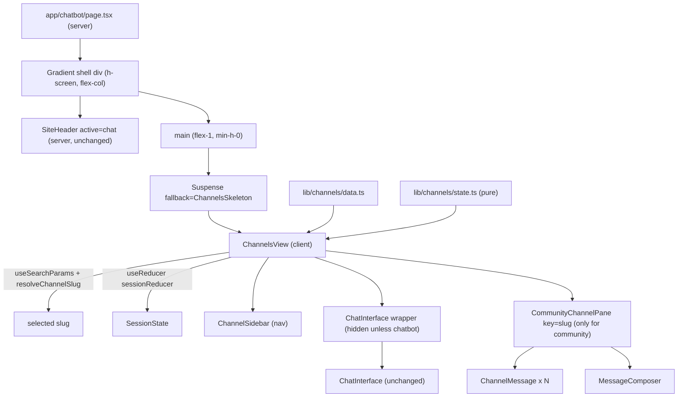
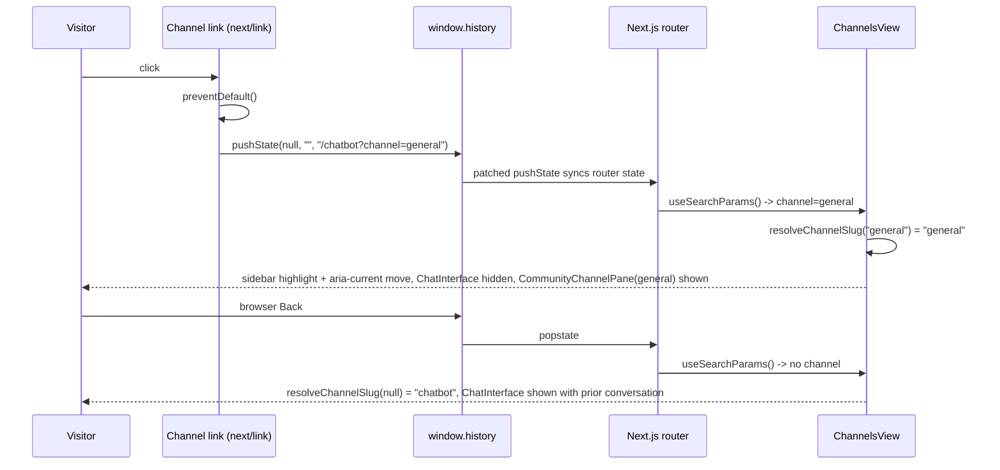

# Design Document: community-channels-layout

## Overview

The `/chatbot` route becomes a Discord-style two-pane page below the unchanged `SiteHeader`: a Channel_Sidebar with a "Community" group (`#general`, `#new-food-places`, `#events`, `#lost-and-found`, `#road-reports`) and an "Assistant" group (`#chatbot`), and a Channel_Pane showing the Selected_Channel.

Confirmed decisions (from requirements): selection lives in the `?channel=<slug>` query parameter; missing or unknown values open `#chatbot`; visitor-posted messages live in React state only and are lost on reload.

Key design decisions:

1. **Server shell + one client island.** `app/chatbot/page.tsx` stays a server component and renders the gradient shell, `<SiteHeader active="chat" />`, and `<main>`. Everything that depends on the URL lives in one client component, `ChannelsView`, wrapped in `<Suspense fallback={<ChannelsSkeleton />}>`. With Cache Components enabled, reading `useSearchParams()` in a client component outside `<Suspense>` breaks prerendering (the same failure this project already hit with `usePathname()`). Next.js docs state that `useSearchParams()` causes the tree up to the closest Suspense boundary to be client-rendered on prerendered routes ([Missing Suspense boundary with useSearchParams](https://nextjs.org/docs/messages/missing-suspense-with-csr-bailout), [Entire page deopted into client-side rendering](https://nextjs.org/docs/messages/deopted-into-client-rendering)). Scoping the boundary to `ChannelsView` keeps the header in the static shell. The page does not read the `searchParams` prop, so the route is not forced dynamic.
2. **Shallow URL updates through the native History API.** Channel entries are `next/link` anchors with `href="/chatbot?channel=<slug>"` (so they are real, Tab-reachable links that open in a new tab with modifier keys). For plain primary clicks, an `onClick` handler calls `event.preventDefault()` and `window.history.pushState(null, "", href)`. The Next.js docs say `pushState`/`replaceState` calls integrate with the router and keep `useSearchParams` in sync ([Linking and Navigating: Native History API](https://nextjs.org/docs/app/getting-started/linking-and-navigating)). This switches channels with no server round trip, and browser back/forward updates `useSearchParams` (Requirement 3.5). If shallow updates misbehave during implementation, the fallback is to let `Link` navigate normally. App Router keys page state without search params, so client state should survive, but that fallback has to be re-verified against Requirement 4.4.
3. **ChatInterface stays mounted and is hidden.** `ChannelsView` always renders `<ChatInterface />` inside a wrapper that gets the `hidden` class when `#chatbot` is not selected. `display: none` keeps React state, so the AI conversation survives channel switches (Requirement 4.4), and `ChatInterface.tsx` needs **no changes**.
4. **Session messages are lifted into `ChannelsView`.** A pure reducer in `lib/channels/state.ts` holds `Record<CommunitySlug, SessionMessage[]>`. Community panes can remount per channel (`key={slug}`) and still show earlier posts (Requirement 6.6). Nothing is sent to a server (Requirement 6.7).
5. **Lightweight local types.** `types/index.ts` `Channel`/`Message`/`User` are heavier than needed (member counts, emails, roles). New types live in `lib/channels/data.ts`. Existing `components/channels/MessageThread.tsx` and `MessageInput.tsx` are left untouched (Requirement 8.3). New components go in new files under `components/channels/`.
6. **Deterministic timestamps.** Demo messages carry fixed ISO strings. All times render through one `Intl.DateTimeFormat("en-US", { timeZone: "America/New_York", ... })` formatter, so server and client output match (no hydration mismatch, no `Date.now()`/`new Date()` during render). `new Date().toISOString()` is called only inside the composer's submit handler.

Files changed or added:

| File | Change |
|---|---|
| `my-app/app/chatbot/page.tsx` | Modified: replace the single card with `<Suspense><ChannelsView /></Suspense>` |
| `my-app/lib/channels/data.ts` | New: channel definitions, demo messages, types |
| `my-app/lib/channels/state.ts` | New: pure logic (slug resolution, text preparation, reducer, selectors, time formatting) |
| `my-app/components/channels/ChannelsView.tsx` | New: client island, URL → selection, session state, layout |
| `my-app/components/channels/ChannelSidebar.tsx` | New: `nav` with grouped channel links |
| `my-app/components/channels/CommunityChannelPane.tsx` | New: header, demo banner, message log, composer |
| `my-app/components/channels/ChannelMessage.tsx` | New: one message row (avatar, name, time, text) |
| `my-app/components/channels/MessageComposer.tsx` | New: textarea + Send |
| `my-app/components/channels/ChannelsSkeleton.tsx` | New: Suspense fallback |

Not modified: `SiteHeader.tsx`, `app/page.tsx`, `ChatInterface.tsx`, `/api/chatbot`, `data/Lowell.md`, `(dashboard)` routes, `/api/channels`, `components/channels/MessageThread.tsx`, `components/channels/MessageInput.tsx`, `types/index.ts`.

## Architecture



### Channel switch flow



### Layout

- Shell (unchanged classes): `flex h-screen flex-col overflow-hidden bg-gradient-to-b from-emerald-50 via-white to-emerald-50 text-zinc-900 dark:from-zinc-950 dark:via-black dark:to-zinc-950 dark:text-zinc-50`.
- `main`: `flex min-h-0 flex-1 overflow-hidden p-4 sm:p-6`. `ChannelsView` root: `mx-auto flex min-h-0 w-full max-w-6xl flex-1 flex-col gap-4 md:flex-row`.
- Sidebar card: `shrink-0 max-h-[25vh] overflow-y-auto rounded-2xl border border-black/5 bg-white shadow-sm dark:border-white/10 dark:bg-zinc-900 md:max-h-none md:w-64`. On a Narrow_Viewport it stacks above the pane and scrolls internally within 25vh (Requirement 1.4). On a Wide_Viewport it is a fixed-width left column at full height.
- Pane card: `flex min-h-0 flex-1 flex-col overflow-hidden rounded-2xl border border-black/5 bg-white shadow-sm dark:border-white/10 dark:bg-zinc-900`. Inside it: a header row (`border-b border-black/5 px-4 py-3 dark:border-white/10`), then a `min-h-0 flex-1` body. Only the message log scrolls (`overflow-y-auto`), so the header and sidebar stay in place (Requirement 1.7).

## Components and Interfaces

### `app/chatbot/page.tsx` (server component, modified)

```tsx
import { Suspense } from "react";
import { SiteHeader } from "@/components/layout/SiteHeader";
import ChannelsView from "@/components/channels/ChannelsView";
import ChannelsSkeleton from "@/components/channels/ChannelsSkeleton";

export default function ChatbotPage() {
  return (
    <div className="flex h-screen flex-col overflow-hidden bg-gradient-to-b from-emerald-50 via-white to-emerald-50 text-zinc-900 dark:from-zinc-950 dark:via-black dark:to-zinc-950 dark:text-zinc-50">
      <SiteHeader active="chat" />
      <main className="flex min-h-0 flex-1 overflow-hidden p-4 sm:p-6">
        <Suspense fallback={<ChannelsSkeleton />}>
          <ChannelsView />
        </Suspense>
      </main>
    </div>
  );
}
```

It does not read `searchParams`, `cookies()`, `headers()`, or the current time.

### `ChannelsView` (client, `"use client"`, default export)

Responsibilities:
- `const slug = resolveChannelSlug(useSearchParams().get("channel"))`.
- `const [session, dispatch] = useReducer(sessionReducer, undefined, createInitialSessionState)`.
- Renders `<ChannelSidebar selected={slug} />`.
- Renders the pane card. Inside it:
  - Chatbot wrapper: `<div className={cn("flex min-h-0 flex-1 flex-col", slug !== "chatbot" && "hidden")}>` containing the CivicBot header (h2 "CivicBot", "AI" pill, city pill with `APP_CONFIG.defaultCity`) and `<div className="min-h-0 flex-1"><ChatInterface /></div>`. This is always mounted.
  - When `slug !== "chatbot"`: `<CommunityChannelPane key={slug} channel={getChannel(slug)} messages={getChannelMessages(slug, session)} onPost={(text) => dispatch({ type: "post", channel: slug, text, id: `session-${nextId.current++}`, timestamp: new Date().toISOString() })} />`. `nextId` is a `useRef(0)` counter. `id`/`timestamp` are created in the event handler and passed in, so the reducer stays pure. A ref counter is used instead of `crypto.randomUUID()` because `randomUUID` is unavailable on plain-HTTP LAN origins (e.g. a phone hitting the dev server by IP).

### `ChannelSidebar` (client)

```ts
interface ChannelSidebarProps { selected: ChannelSlug }
```

- Root: `<nav aria-label="Channels" className="...sidebar card classes...">`.
- Top: `<h2 className="text-lg font-bold">{APP_CONFIG.defaultCity}</h2>` with a muted subtitle "Community channels" (Requirement 2.5).
- One `<section>` per group, in order Community, Assistant. Each has `<h3 className="px-2 text-xs font-semibold uppercase tracking-wide text-zinc-600 dark:text-zinc-400">` and a `<ul>` of entries (Requirement 7.2).
- Entry: `<Link href={channelHref(slug)} prefetch={false} aria-current={isSelected ? "page" : undefined} onClick={handleClick}>`.
  - Visible text: `<span aria-hidden="true">#</span>{slug}`. The `#` is visible but not spoken.
  - Chatbot entry adds `<BotIcon />` (inline SVG, `aria-hidden="true"`, defined locally in this file in the same style as `NavIcons.tsx`) and an "AI" pill `<span className="rounded-full bg-emerald-100 px-1.5 text-[10px] font-bold text-emerald-800 dark:bg-emerald-500/15 dark:text-emerald-200">AI</span>`. That pill text becomes part of the accessible name ("chatbot AI") (Requirements 2.4, 7.7).
  - Classes: base `flex items-center gap-2 rounded-lg px-2 py-1.5 text-sm font-medium focus-visible:outline-none focus-visible:ring-2 focus-visible:ring-emerald-500 focus-visible:ring-offset-2 focus-visible:ring-offset-white dark:focus-visible:ring-offset-zinc-900` (Requirement 7.4).
    - Selected: `bg-emerald-100 text-emerald-800 dark:bg-emerald-500/15 dark:text-emerald-200` (Requirement 2.6).
    - Unselected: `text-zinc-700 hover:bg-zinc-100 dark:text-zinc-300 dark:hover:bg-white/5`.
- `handleClick(e)`: if `e.button === 0` and no `metaKey/ctrlKey/shiftKey/altKey`, then `e.preventDefault()` and, unless the slug is already selected, `window.history.pushState(null, "", href)`. Otherwise default link behavior runs (new tab/window).

### `CommunityChannelPane` (client)

```ts
interface CommunityChannelPaneProps {
  channel: ChannelDef;              // group === "community"
  messages: readonly DisplayMessage[]; // demo then session, from getChannelMessages
  onPost: (text: string) => void;   // receives already-prepared text
}
```

- Header: `<h2 className="text-lg font-bold">#{channel.slug}</h2>` and `<p className="truncate text-sm text-zinc-600 dark:text-zinc-400">{channel.description}</p>` (Requirement 3.6).
- Demo_Label banner: `<p className="mx-4 mt-3 rounded-xl border border-amber-200 bg-amber-50 px-3 py-2 text-xs font-medium text-amber-900 dark:border-amber-500/30 dark:bg-amber-500/10 dark:text-amber-200"><strong>DEMO / FICTIONAL</strong>: sample messages for illustration only. Not from the City of Lowell, and not real reports, closures, or emergencies.</p>` (Requirements 5.4, 7.8).
- Log: `<div ref={logRef} role="log" aria-label={`Messages in #${channel.slug}`} className="min-h-0 flex-1 space-y-4 overflow-y-auto p-4">`. `role="log"` implies `aria-live="polite"` (Requirement 7.5).
- Scroll: `useEffect(() => { const el = logRef.current; if (el) el.scrollTop = el.scrollHeight; }, [messages.length])`. Because of `key={slug}`, this also runs on channel change, which covers Requirement 5.6. It sets `scrollTop` on the log container, not `scrollIntoView`, so the page itself never scrolls.
- Footer: `<MessageComposer channelSlug={channel.slug} onSubmit={onPost} />`.

### `ChannelMessage` (no directive, rendered from client components)

```ts
interface ChannelMessageProps { message: DisplayMessage }
```

- Avatar: `<span aria-hidden="true" className="flex h-9 w-9 shrink-0 items-center justify-center rounded-full bg-gradient-to-br from-emerald-500 to-teal-600 text-sm font-bold text-white">{authorInitial(message.author)}</span>`. The session author "You" uses `bg-zinc-700` instead, to set it apart.
- Line 1: author `<span className="font-semibold">`, then `<time dateTime={message.timestamp} className="text-xs text-zinc-600 dark:text-zinc-400">{formatMessageTime(message.timestamp)}</time>`.
- Line 2: `<p className="whitespace-pre-wrap break-words text-sm text-zinc-800 dark:text-zinc-200">{message.text}</p>`. This is plain React text (escaped, no Markdown, no `dangerouslySetInnerHTML`) with line breaks preserved (Requirements 5.3, 6.8).
- Demo messages add a small `DEMO` tag next to the time (`text-[10px] font-semibold uppercase text-amber-800 dark:text-amber-300`).

### `MessageComposer` (client)

```ts
interface MessageComposerProps { channelSlug: CommunitySlug; onSubmit: (text: string) => void }
```

- `const [draft, setDraft] = useState("")`; `const prepared = prepareMessageText(draft)`.
- `<form onSubmit>` with a visually hidden `<label htmlFor=...>Message #{channelSlug}</label>`. Then `<textarea id=... rows={1} maxLength={MAX_MESSAGE_LENGTH} placeholder={`Message #${channelSlug}`} className="max-h-32 flex-1 resize-none rounded-2xl border border-black/10 bg-white px-4 py-2 text-sm focus:outline-none focus:ring-2 focus:ring-emerald-500 dark:border-white/10 dark:bg-zinc-900">` (Requirements 6.1, 6.5, 7.6).
- Send button: same classes as ChatInterface's Send (`rounded-full bg-emerald-600 ... disabled:opacity-50`), `type="submit"`, `disabled={prepared === null}` (Requirement 6.4).
- `onKeyDown`: if `e.key === "Enter" && !e.shiftKey && !e.nativeEvent.isComposing`, then `e.preventDefault()` and submit if `prepared !== null`. Shift+Enter falls through to the textarea default and inserts a newline (Requirements 6.2, 6.3).
- Submit: `if (prepared === null) return; onSubmit(prepared); setDraft("");`.

### `ChannelsSkeleton` (server-safe, no hooks)

Has the same two-card geometry as `ChannelsView`: a sidebar card with six `animate-pulse` bars and a pane card with a header bar and three message placeholders. The root has `aria-busy="true"` and an sr-only "Loading channels…". It avoids layout shift when the client island resolves.

### `lib/channels/state.ts` (pure, no React, no DOM)

```ts
export const DEFAULT_CHANNEL: ChannelSlug = "chatbot";
export const MAX_MESSAGE_LENGTH = 1000;
export const VISITOR_DISPLAY_NAME = "You";

export function isChannelSlug(value: string): value is ChannelSlug;
// Exact, case-sensitive match against CHANNELS; anything else (null, "", "General", "bogus") -> "chatbot"
export function resolveChannelSlug(raw: string | null | undefined): ChannelSlug;
export function channelHref(slug: ChannelSlug): string; // `/chatbot?channel=${slug}`
export function getChannel(slug: ChannelSlug): ChannelDef;

// Trims leading/trailing whitespace only (internal newlines kept).
// Returns null if the result is empty or longer than MAX_MESSAGE_LENGTH.
export function prepareMessageText(raw: string): string | null;

export type SessionState = Readonly<Record<CommunitySlug, readonly SessionMessage[]>>;
export type SessionAction = {
  type: "post"; channel: CommunitySlug; text: string; id: string; timestamp: string;
};
export function createInitialSessionState(): SessionState; // every community slug -> []
// For "post": prepares text; if null, returns the same state object. Otherwise returns a new
// state with one message appended to state[channel], author = VISITOR_DISPLAY_NAME; other
// channels keep their array references.
export function sessionReducer(state: SessionState, action: SessionAction): SessionState;

export function getChannelMessages(slug: CommunitySlug, state: SessionState): DisplayMessage[];
// = [...DEMO_MESSAGES[slug] (kind "demo"), ...state[slug] (kind "session")]

export function authorInitial(name: string): string;   // first non-space char uppercased, "?" if none
export function formatMessageTime(iso: string): string; // Intl en-US, America/New_York, e.g. "Oct 18, 2:15 PM"
```

The reducer runs `prepareMessageText` again even though the composer already prepared the text. That keeps the invariants (non-empty, ≤1000 chars, trimmed) enforced in one testable place.

## Data Models

Defined in `my-app/lib/channels/data.ts`:

```ts
export const COMMUNITY_SLUGS = [
  "general", "new-food-places", "events", "lost-and-found", "road-reports",
] as const;
export type CommunitySlug = (typeof COMMUNITY_SLUGS)[number];
export type ChannelSlug = CommunitySlug | "chatbot";

export interface ChannelDef {
  slug: ChannelSlug;
  description: string;            // one line, shown in pane header
  group: "community" | "assistant";
}

export const CHANNEL_GROUPS = [
  { id: "community", label: "Community" },
  { id: "assistant", label: "Assistant" },
] as const;

// Order defines sidebar order (Requirement 2.1, 2.2).
export const CHANNELS: readonly ChannelDef[] = [
  { slug: "general",         group: "community", description: "Neighborhood chat for anything Lowell." },
  { slug: "new-food-places", group: "community", description: "Share new spots to eat and drink." },
  { slug: "events",          group: "community", description: "Community meetups and happenings." },
  { slug: "lost-and-found",  group: "community", description: "Lost something? Found something? Post it here." },
  { slug: "road-reports",    group: "community", description: "Neighbor notes about streets and sidewalks." },
  { slug: "chatbot",         group: "assistant", description: "Ask CivicBot about Lowell, MA." },
];

export interface DemoMessage {
  id: string;          // e.g. "demo-general-1"
  author: string;      // fictional display name
  timestamp: string;   // fixed ISO 8601 string, ascending within a channel
  text: string;
}

export const DEMO_MESSAGES: Readonly<Record<CommunitySlug, readonly DemoMessage[]>>;
```

In `lib/channels/state.ts`:

```ts
export interface SessionMessage {
  id: string;
  author: typeof VISITOR_DISPLAY_NAME; // "You"
  timestamp: string;                   // ISO, captured in the submit handler
  text: string;                        // prepared: trimmed, 1..1000 chars
}

export type DisplayMessage =
  | (DemoMessage & { kind: "demo" })
  | (SessionMessage & { kind: "session" });
```

### Demo seed content (3 per channel, Requirement 5.2, 5.5)

All names are invented. Locations are generic ("example downtown street"). Nothing describes a current emergency, a closure, or an official City announcement. Timestamps are fixed past dates in October 2026, ascending within each channel.

| Channel | Author | Text (abridged) |
|---|---|---|
| general | Rosa Delgado | "Hi neighbors! Trying out the new community channels. 👋" |
| general | Theo Marchetti | "Welcome! Sample tip: the library is a great place to start if you're new to town." |
| general | Priya Nandakumar | "Anyone up for a weekend walking group around an example riverside path?" |
| new-food-places | Sam Okafor | "Sample post: tried a (fictional) dumpling spot called Little Lantern. Great broth." |
| new-food-places | Lena Kowalski | "Is Maple & Mill Bakery (example name) open on Sundays? Haven't checked yet." |
| new-food-places | Diego Ferreira | "Reminder: always confirm hours and allergen info with the restaurant directly." |
| events | Hannah Brooks | "Example event: neighborhood book swap at an example community room." |
| events | Marcus Lee | "Sample listing: Saturday garden volunteer morning at an example park." |
| events | Aisha Rahman | "These are demo listings. Check official sources for real event times." |
| lost-and-found | Owen Fitzgerald | "Sample: found a blue water bottle near an example bus stop." |
| lost-and-found | Mei Chen | "Demo post: lost a gray knit scarf, possibly at an example coffee shop." |
| lost-and-found | Jonah Silva | "Tip: lost items are often turned in at the nearest front desk or office." |
| road-reports | Carla Mendes | "Demo note: sample pothole on an example residential street, marked resolved." |
| road-reports | Ben Adeyemi | "Example: streetlight out on a sample side street, report submitted (fictional)." |
| road-reports | Grace Park | "For real road issues, use the city's official service request channels." |

The full strings are written during implementation. Each one must keep this table's tone and the Lowell.md Section 9 demo rules.

### Invariants

- `CHANNELS` slugs are unique and match `/^[a-z]+(-[a-z]+)*$/`. Exactly one channel is in the assistant group, and its slug is `chatbot`.
- `DEMO_MESSAGES[slug].length >= 3` for every `CommunitySlug`. Ids are unique, and timestamps ascend within each channel.
- Every `SessionMessage.text` equals `prepareMessageText(text)` (trimmed, non-empty, ≤1000 chars).

## Correctness Properties

*A property is a characteristic or behavior that should hold true across all valid executions of a system-essentially, a formal statement about what the system should do. Properties serve as the bridge between human-readable specifications and machine-verifiable correctness guarantees.*

These properties target the pure module `lib/channels/state.ts`. Layout, styling, History API, and accessibility criteria are covered by example and manual checks in the Testing Strategy.

After reflection, the resolution criteria (3.2, 3.3, 3.4) collapse into one total-function property. The two invalid-text criteria (6.4, 6.5) collapse into one rejection property. Ordering (5.1) and per-channel survival (6.6) collapse into one model-based property. Valid posting (6.2) and text preservation (6.8) collapse into one append property.

### Property 1: Channel resolution is total and exact

*For any* input `raw` that is `null`, `undefined`, or an arbitrary string (including the empty string, case variants such as `"General"`, whitespace-padded slugs such as `" general"`, and random Unicode), `resolveChannelSlug(raw)` returns a slug present in `CHANNELS`. The result equals `raw` exactly when `raw` is one of the six Channel_Slugs, and equals `"chatbot"` otherwise.

**Validates: Requirements 3.2, 3.3, 3.4**

### Property 2: Channel link round trip

*For any* `ChannelSlug` `s`, parsing `channelHref(s)` with `new URL(channelHref(s), "http://localhost")` yields pathname `/chatbot`, and `resolveChannelSlug(url.searchParams.get("channel"))` equals `s`.

**Validates: Requirements 3.1, 3.2**

### Property 3: Valid posts append one prepared visitor message

*For any* session state reachable from `createInitialSessionState()`, any `CommunitySlug` `c`, any id, any ISO timestamp, and any raw text whose trimmed length is between 1 and 1000, dispatching `{ type: "post", channel: c, text: raw, id, timestamp }` to `sessionReducer` produces a state where `next[c]` equals `prev[c]` followed by exactly one message `{ id, author: "You", timestamp, text: raw.trim() }`. Internal whitespace and newlines of `raw` are preserved verbatim.

**Validates: Requirements 6.2, 6.8**

### Property 4: Invalid text is rejected without changing state

*For any* raw text that is empty, consists only of whitespace (spaces, tabs, newlines, other Unicode whitespace), or has a trimmed length greater than 1000, `prepareMessageText(raw)` returns `null`, and `sessionReducer(state, post(raw))` returns the identical `state` object for any reachable state and any channel.

**Validates: Requirements 6.4, 6.5**

### Property 5: Channel messages match the demo-then-posted model

*For any* sequence of post actions with random target channels and a mix of valid and invalid texts, applied in order from `createInitialSessionState()`, every `CommunitySlug` `c` satisfies this: `getChannelMessages(c, finalState)` equals `DEMO_MESSAGES[c]` (tagged `kind: "demo"`, original order) followed by the valid actions that targeted `c`, in dispatch order (tagged `kind: "session"`, text trimmed). As a consequence, posts to one channel never change another channel's messages, and earlier posts remain after any number of later actions.

**Validates: Requirements 5.1, 6.6**

### Property 6: Message metadata rendering helpers are total and deterministic

*For any* author string, `authorInitial(name)` returns the uppercased first non-whitespace code point of `name`, or `"?"` if `name` has no non-whitespace character. *For any* date between 2000-01-01 and 2100-01-01 expressed as an ISO string, `formatMessageTime(iso)` returns a non-empty string, and calling it twice with the same input returns the same string.

**Validates: Requirements 5.3**

## Error Handling

| Condition | Behavior |
|---|---|
| `?channel` missing, empty, unknown, or wrong case | `resolveChannelSlug` returns `"chatbot"`. No error UI, and the URL is left as-is (not rewritten). |
| `?channel` repeated (`?channel=a&channel=b`) | `URLSearchParams.get` returns the first value, which is then resolved normally. |
| Whitespace-only or over-limit text | Send button disabled, Enter ignored, and the reducer returns the same state (defense in depth). `maxLength={1000}` stops typing/pasting past the limit. |
| IME composition Enter (e.g. Japanese input) | `isComposing` check prevents a premature submit. |
| User-supplied HTML/Markdown in posts | Rendered as escaped React text, never as HTML. No XSS surface. |
| ChatInterface API errors / loading | Handled inside the unchanged `ChatInterface`. A request still in flight when the visitor switches away resolves into the hidden, still-mounted component. |
| Modifier-click / middle-click on a channel | Not intercepted, so the browser opens `/chatbot?channel=<slug>` in a new tab, and the new tab resolves the slug on load. |
| JavaScript disabled or not yet hydrated | The static shell and header render. `ChannelsView` is client-rendered under Suspense, so the skeleton shows until JS loads. Acceptable for this proof of concept. |
| Server/client time formatting differences | Avoided with a fixed `en-US` locale and `America/New_York` time zone, plus fixed demo ISO timestamps. No `Date.now()`/`new Date()` in render paths. |
| Reload | Session messages and the AI conversation are cleared (confirmed decision). Demo messages reappear. |

## Testing Strategy

### Dual approach

- **Property-based tests** cover the pure logic in `lib/channels/state.ts` (Properties 1–6).
- **Example unit tests** cover fixed data invariants in `lib/channels/data.ts`:
  - community order is exactly the five slugs (2.1)
  - assistant group is `["chatbot"]` (2.2)
  - slugs are unique and kebab-case
  - every channel has a non-empty, single-line description (3.6)
  - every community channel has ≥3 demo messages with unique ids and ascending timestamps (5.2)
  - a keyword denylist check on demo text (e.g. "emergency", "closed today", "City of Lowell announces"), as a backstop to manual content review against Lowell.md Section 9 (5.5)
- **Build, lint, and smoke checks** cover framework integration.
- **Manual browser checks** cover layout, interaction, and accessibility.

### Tooling (new dev dependencies, flagged)

`my-app/` has no test framework today. This design adds two **dev-only** dependencies, installed with exact pinned versions (`npm i -D -E vitest fast-check`):

- [Vitest](https://vitest.dev/) as the runner. It is TypeScript-native and needs no Babel or Jest config.
- [fast-check](https://fast-check.dev/) for property-based testing. Properties are not hand-rolled.

Setup:
- Add `"test": "vitest --run"` to `package.json` scripts. Use single-run mode, never watch.
- Add a minimal `vitest.config.ts` with `resolve.alias` mapping `@` to the app root, so no extra path plugin is needed.
- Tests live in `my-app/lib/channels/state.test.ts` and `my-app/lib/channels/data.test.ts`. They import `describe/it/expect` explicitly from `vitest` (no globals), so `tsc` and ESLint need no new global types.

If the team prefers not to add dependencies, the fallback is to drop the test files and rely on the build, lint, and manual checks below. That loses automated coverage of Properties 1–6.

### Property test configuration

- Each property is implemented by **one** `fc.assert(fc.property(...), { numRuns: 100 })` test (minimum 100 iterations).
- Each test carries a tag comment in the form `// Feature: community-channels-layout, Property {n}: {property title}`.
- Generators:
  - slug inputs: `fc.oneof(fc.constantFrom(...slugs), fc.string(), fc.string({ unit: "binary" }), fc.constant(null), fc.constant(undefined), slug case/whitespace mutations)`
  - whitespace-only text: `fc.string({ unit: fc.constantFrom(" ", "\t", "\n", "\r", "\u00a0", "\u2003") })`
  - These use the fast-check v4 API (`fc.string({ unit })`). Older helpers like `stringOf`/`fullUnicodeString` were removed in v4.
  - valid text: strings with 1–1000 trimmed characters, including internal newlines
  - over-limit text: length 1001–3000
  - action sequences: `fc.array(postAction, { maxLength: 50 })`

### Build and smoke verification

Run from `my-app/`:
1. `npx tsc --noEmit`: no type errors.
2. `npm run lint`: no new errors in changed files (8.5).
3. `npm run build`: succeeds with Cache Components enabled. This catches any `useSearchParams` outside `<Suspense>` and any time access during prerender (8.4).
4. `npm test`: all property and example tests pass.
5. With the dev server running on `localhost:3000` (started manually by the developer), check:
   - `curl -s -o /dev/null -w "%{http_code}"` returns 200 for `/chatbot`, `/chatbot?channel=general`, and `/chatbot?channel=bogus`.
   - The HTML contains the `SiteHeader` "City Land" heading and an `aria-current="page"` Chat link pointing to `/chatbot` (1.1, 3.7).
   - Because `ChannelsView` may be client-rendered behind Suspense, channel-specific content is verified in the browser rather than relied on in curl output.
6. `git diff --stat` shows no changes to these files (8.1–8.3): `SiteHeader.tsx`, `app/page.tsx`, `ChatInterface.tsx`, `app/api/chatbot/route.ts`, `data/Lowell.md`, `(dashboard)/**`, `app/api/channels/route.ts`, `components/channels/MessageThread.tsx`, `components/channels/MessageInput.tsx`.
7. Grep `components/channels/{ChannelsView,ChannelSidebar,CommunityChannelPane,MessageComposer,ChannelMessage}.tsx` and `lib/channels/*` for `fetch(` and expect none (6.7).

### Manual browser checklist

- **Layout:** check wide (≥768px) and narrow (<768px) widths. The narrow sidebar must stay ≤25vh and scroll. Check light and dark mode (1.2–1.7).
- **Sidebar:** two groups in order; `#` prefixes; bot icon + AI pill on `#chatbot`; Lowell, MA heading; emerald highlight that moves with the selection (2.1–2.6).
- **Selection and URL:** click each channel and confirm the URL updates and there is no full reload. Then:
  - Back/Forward restores the previous channel (3.1, 3.5).
  - Reloading `?channel=events` opens `#events` (3.2).
  - `/chatbot` and `?channel=bogus` open `#chatbot` (3.3, 3.4).
  - The header shows the name and description (3.6).
- **Chatbot:** CivicBot header with AI and city pills (4.2). Ask one question and get a Markdown reply. Switch to `#general` and back: the conversation is still there (4.1, 4.3, 4.4).
- **Community channels:**
  - DEMO / FICTIONAL banner (5.4); demo messages show name, initial avatar, and time (5.3); the list auto-scrolls to the newest message (5.6).
  - Placeholder reads `Message #<slug>` (6.1). Enter sends, Shift+Enter adds a newline, and a whitespace-only draft keeps Send disabled (6.2–6.4).
  - Pasting more than 1000 chars truncates at 1000 (6.5). Posts survive switching away and back (6.6).
  - The DevTools Network tab shows no request on send (6.7). Posting `<b>hi</b>` shows literal text (6.8).
- **Accessibility:**
  - Tab through the sidebar links and check the focus ring is visible (7.2, 7.4).
  - In the DevTools accessibility tree, check: the `nav` is named "Channels", group headings exist, `aria-current` is on exactly one entry, the log region is present, the composer label names the channel, and the chatbot entry's name is "chatbot AI" (7.1–7.3, 7.5–7.7).
  - Check the selected-entry, body-text, timestamp, and banner color pairs with a contrast checker in both schemes (7.8). Full WCAG validation needs manual testing with assistive technologies and expert accessibility review.
