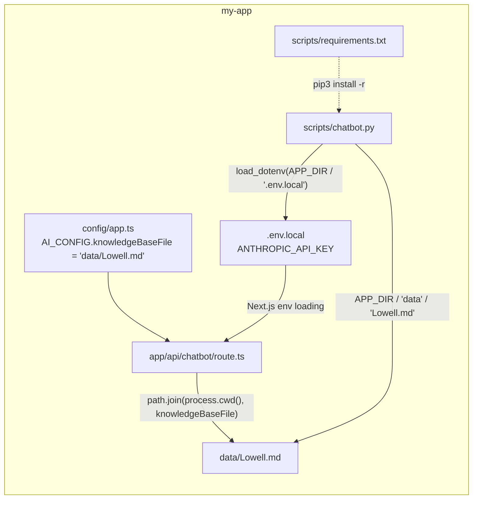

# Design Document: Relocate Chatbot into my-app

## Overview

This change moves three root-level files into the Next.js app directory so `my-app/` is self-contained:

| Old path (Repo_Root) | New path |
| --- | --- |
| `Lowell.md` | `my-app/data/Lowell.md` |
| `chatbot.py` | `my-app/scripts/chatbot.py` |
| `requirements.txt` | `my-app/scripts/requirements.txt` |

Two consumers read the knowledge base: the Next.js route handler (`POST /api/chatbot`) and the Python CLI. Both are updated to the new location. The Python CLI also switches its env source from an implicit `.env` lookup to `my-app/.env.local`, so one file holds `ANTHROPIC_API_KEY` for both. Code comments and steering docs are updated to match. No behavior changes beyond path resolution and env loading.

## Architecture



Path anchoring:

- Next.js: `process.cwd()` is `my-app/` for `next dev`, `next build`, and `next start` run from `my-app/`. The knowledge base path is resolved inside the project root instead of via `..`.
- Python: paths are anchored on `Path(__file__).resolve()`, so the CLI's working directory does not matter. `APP_DIR = Path(__file__).resolve().parent.parent` resolves to `my-app/`.

## Components and Interfaces

### 1. File moves

Create the target directories, then move with history preserved:

```bash
mkdir -p my-app/data my-app/scripts
git mv Lowell.md my-app/data/Lowell.md
git mv chatbot.py my-app/scripts/chatbot.py
git mv requirements.txt my-app/scripts/requirements.txt
```

Before moving, check tracking status with `git ls-files --error-unmatch <file>`. `git mv` fails on untracked files; for any untracked file, use plain `mv` and report that it has no git history (Requirement 1.4). As of this spec, `git status` reports all three files as untracked (`??`), so plain `mv` is the expected path; the tracking check stays in case that changes before implementation.

Because untracked files have no git baseline, record one before moving: `shasum -a 256 Lowell.md requirements.txt chatbot.py`, and copy `chatbot.py` to a temp file (e.g. `/tmp/chatbot.py.orig`) so the later edit can be diffed against the original. The temp file is deleted after verification.

Check `my-app/.gitignore` to confirm it does not ignore `data/` or `scripts/`. Adding `__pycache__/` to `my-app/.gitignore` is optional; `chatbot.py` is run as a script, so Python does not write bytecode for it, and no `__pycache__` is expected.

### 2. App_Config (`my-app/config/app.ts`)

```ts
// Before
// Knowledge base lives at the repo root (one level above my-app)
knowledgeBaseFile: "Lowell.md",

// After
// Knowledge base path, relative to the app directory (my-app/data/Lowell.md)
knowledgeBaseFile: "data/Lowell.md",
```

### 3. Chatbot_API (`my-app/app/api/chatbot/route.ts`)

Only the path expression and its comment change. Caching and error handling stay as-is.

```ts
let knowledgeBaseCache: string | null = null;

async function loadKnowledgeBase(): Promise<string> {
  // In development, re-read every request so edits to Lowell.md show up immediately.
  const useCache = process.env.NODE_ENV === "production";
  if (useCache && knowledgeBaseCache !== null) return knowledgeBaseCache;

  // Knowledge base lives at my-app/data/Lowell.md; process.cwd() is my-app/.
  const filePath = path.join(process.cwd(), AI_CONFIG.knowledgeBaseFile);
  const content = await readFile(filePath, "utf-8");
  if (useCache) knowledgeBaseCache = content;
  return content;
}
```

The comment on line 32 that references the Python prototype is updated to name `my-app/scripts/chatbot.py`.

### 4. Prompt module comment (`my-app/lib/ai/prompts/chatbot.ts`)

Line 6, "Mirrors the behavior of the Python `chatbot.py` prototype", becomes a reference to `my-app/scripts/chatbot.py`. No code changes.

### 5. Python_CLI (`my-app/scripts/chatbot.py`)

Only the env loading and knowledge base path change. System prompt, model (`claude-haiku-5-5`), loop, and error handling are unchanged.

```python
import os
from pathlib import Path

import anthropic
from dotenv import load_dotenv

# my-app/ (this file lives in my-app/scripts/)
APP_DIR = Path(__file__).resolve().parent.parent

# Load environment variables from the same file the web app uses
load_dotenv(APP_DIR / ".env.local")

api_key = os.getenv("ANTHROPIC_API_KEY")

if not api_key:
    raise SystemExit("ANTHROPIC_API_KEY is missing.")

# Initialize Claude
client = anthropic.Anthropic(api_key=api_key)

# Load Lowell knowledge base (shared with the web app)
file_path = APP_DIR / "data" / "Lowell.md"
# ... remainder unchanged
```

`load_dotenv` does not override variables already set in the process environment, so an exported `ANTHROPIC_API_KEY` still takes effect. If `.env.local` is missing, `load_dotenv` returns `False` without raising, and the existing missing-key check produces the expected exit message.

### 6. Python_Requirements (`my-app/scripts/requirements.txt`)

Content unchanged (`anthropic==2.3.0`, `python-dotenv==1.2.4`). Install command becomes `pip3 install -r my-app/scripts/requirements.txt` from the Repo_Root.

### 7. Steering_Docs

- `.kiro/steering/structure.md`: update the project tree to show `my-app/data/Lowell.md` and `my-app/scripts/{chatbot.py,requirements.txt}`; remove root-level entries; update file placement guidance (knowledge base content goes in `my-app/data/`, standalone scripts in `my-app/scripts/`).
- `.kiro/steering/tech.md`: state secrets live in `my-app/.env.local`; Python commands are `pip3 install -r my-app/scripts/requirements.txt` and `python3 my-app/scripts/chatbot.py`; remove the known issue calling `claude-haiku-5-5` invalid; remove the note that the web app has no Anthropic integration.
- `.kiro/steering/product.md`: update any references to the knowledge base and prototype locations.

### 8. Root files

`README.md`, `LICENSE`, and `.gitignore` at the Repo_Root are edited only if they reference the old paths. The root `.env` is left untouched; the final summary tells the user it is now redundant.

## Data Models

No data model changes. `AI_CONFIG.knowledgeBaseFile` remains a `string`; its value changes from a Repo_Root-relative name to an App_Dir-relative path.

## Error Handling

| Condition | Behavior |
| --- | --- |
| Knowledge base missing/unreadable (API) | `readFile` rejects inside the existing `try/catch` in `POST`, which returns HTTP 500 with an error message. Unchanged. |
| Knowledge base missing (CLI) | `open()` raises `FileNotFoundError` with the absolute path. Unchanged behavior, new path. |
| `.env.local` missing (CLI) | `load_dotenv` is a no-op; falls through to `ANTHROPIC_API_KEY is missing.` unless the key is exported. |
| File untracked during move | Use `mv` instead of `git mv`; report it. |

Deployment note: `data/` is inside the Next.js project root, which is a better fit for output file tracing than the previous `..` path. If the app is later deployed to a serverless target, `outputFileTracingIncludes` for `/api/chatbot` → `./data/**` may be needed to bundle the file. This is optional and not part of this change.

## Correctness Properties

*A property is a characteristic or behavior that should hold true across all valid executions of a system-essentially, a formal statement about what the system should do. Properties serve as the bridge between human-readable specifications and machine-verifiable correctness guarantees.*

This is a file relocation refactor with no pure logic over a meaningful input space, so property-based testing is not used. The properties below are verified with smoke, example, and integration checks over their small, finite domains.

### Property 1: Every relocated file exists only at its new path

For all files in {`Lowell.md`, `chatbot.py`, `requirements.txt`}, the file exists at its new path under `my-app/`, does not exist at the Repo_Root, and exactly one `Lowell.md` exists in the repository outside `node_modules` and `.next`.

**Validates: Requirements 1.1, 1.2, 1.3, 1.5, 1.6**

### Property 2: Relocated content is preserved

For all relocated files, the content after the move equals the content before the move, except for the Python_CLI lines covering `APP_DIR`, `load_dotenv`, and `file_path`.

**Validates: Requirements 1.4, 1.7, 3.6**

### Property 3: Python_CLI path resolution is independent of working directory

For any working directory from which `python3 <abs-or-rel path>/my-app/scripts/chatbot.py` is launched, the CLI resolves the knowledge base to `<Repo_Root>/my-app/data/Lowell.md` and the env file to `<Repo_Root>/my-app/.env.local`, and loads `ANTHROPIC_API_KEY` and the knowledge base without error.

**Validates: Requirements 3.1, 3.2, 3.3, 3.4, 4.1**

### Property 4: Chatbot_API reads the relocated knowledge base

For any valid request to `POST /api/chatbot`, the handler reads `path.join(process.cwd(), "data/Lowell.md")`, caches it once per process in production, re-reads it per request otherwise, and returns 500 if the read fails.

**Validates: Requirements 2.1, 2.2, 2.3, 2.4, 2.5**

### Property 5: No stale references remain

For all source, config, and steering files in the repository (excluding `node_modules`, `.next`, `.git`, and this spec), no reference points to the root-level `Lowell.md`, `chatbot.py`, or `requirements.txt`.

**Validates: Requirements 5.1, 5.2, 5.3, 5.4, 5.7, 5.8**

## Testing Strategy

`my-app` has no unit test framework, and this change adds no logic worth one. Verification is proportionate:

1. Build and static checks (in `my-app/`):
   - `npx tsc --noEmit`
   - `npx eslint app/api/chatbot/route.ts config/app.ts lib/ai/prompts/chatbot.ts`
   - `npm run build` (Requirement 2.6). Safe while the user's dev server is running: Next.js 16 `next dev` writes to `.next/dev`, separate from the build output in `.next`.
2. File state (Property 1, 2):
   - `test ! -e Lowell.md && test ! -e chatbot.py && test ! -e requirements.txt` at Repo_Root.
   - SHA-256 of `my-app/data/Lowell.md` and `my-app/scripts/requirements.txt` matches the pre-move baseline.
   - `diff /tmp/chatbot.py.orig my-app/scripts/chatbot.py` shows only the `APP_DIR`, `load_dotenv`, and `file_path` changes; the system prompt is untouched (Requirement 1.7). Delete the temp copy afterwards.
   - If any file was tracked and moved with `git mv`, `git status` shows it as a rename (`R`).
3. Web integration (Property 4): with the dev server running from `my-app/`, POST to `http://localhost:3000/api/chatbot` with "Who is the mayor of Lowell?" and confirm the answer cites Erik Gitschier from the knowledge base. The user should start `npm run dev` manually if it isn't already running.
4. Python integration (Property 3): run the CLI non-interactively from two working directories, never printing the key:
   - From Repo_Root: `echo exit | python3 my-app/scripts/chatbot.py` → exit code 0, no traceback.
   - From `/tmp`: `echo exit | python3 /Users/saadkapadia/Desktop/Hackachusetts/my-app/scripts/chatbot.py` → exit code 0, no traceback.
   - To isolate the `.env.local` source, run one check with `ANTHROPIC_API_KEY` unset in the shell (`env -u ANTHROPIC_API_KEY ...`).
   - Requirement 3.7: `pip3 install --dry-run -r my-app/scripts/requirements.txt` from Repo_Root resolves without errors. The packages are already installed, so this confirms the relocated path and pins without changing the environment; the CLI runs above confirm the imports work.
5. Stale references (Property 5): `grep -rn` for `Lowell.md`, `chatbot.py`, and `requirements.txt`, excluding `node_modules`, `.next`, `.git`, `.kiro/specs/relocate-chatbot-into-my-app`, and `.env*` files (so secret files are never read or echoed), and confirm every hit uses the new paths.
6. Root `.env`: confirm it still exists and mention in the final summary that it can be removed (Requirement 4.2, 4.3).
